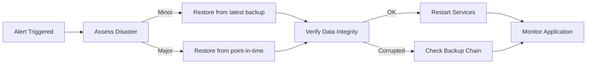

# Estim AI Platform - Data Flow Documentation

## 1. Data Flow Overview

This document describes the data flow through the Estim AI Platform, from user interactions through the various layers to data storage and AI/ML processing.

## 2. Request Flow (Synchronous)

### 2.1 User → API Request Flow

```text
User/Browser → Next.js Frontend → FastAPI Gateway → Auth Middleware → Route Handler → Module Service → Domain Entity → PostgreSQL
```

### 2.2 Request Processing Flow

1. **Client Side (Next.js)**
   - User interacts with dashboard
   - API calls made via `fetch()` or `axios`
   - Request includes `Authorization: Bearer <token>` header

2. **API Gateway (FastAPI)**
   - Middleware processes request (CORS, authentication, logging)
   - Route handler dispatches to appropriate module
   - Request validation via Pydantic schemas

3. **Module Service**
   - Business logic executed
   - Domain entities validated
   - Cross-module communication via events

4. **Data Layer**
   - SQLAlchemy ORM queries module schema
   - Transactions managed via context manager
   - Results returned as domain entities


### 4.2 Data Lifecycle

| Stage | Storage | Retention | Access |
|-------|---------|-----------|--------|
| **Active Data** | PostgreSQL (primary) | Current year | Application only |
| **Archived Data** | PostgreSQL (archive schema) | 2-3 years | Admin + reporting |
| **ML Embeddings** | MLflow + Redis cache | Model-specific | ML engineers |
| **Logs/Traces** | Logstash → Elasticsearch | 30 days | Observability stack |
| **Metrics** | Prometheus | 15 days | Monitoring stack |
| **Backups** | S3/MinIO | 30 days | DevOps |
| **Audit Logs** | PostgreSQL + archive | 7 years | Compliance

## 7. Data Security Flow

### 7.1 Authentication Flow

```text
User → Login form → POST /auth/login → Verify credentials → Generate JWT → Return token
            → Client stores token → Include in requests → Middleware validates → Request processed
```

### 7.2 Authorization Flow

## 8. Data Processing Flow (AI/ML)

### 8.1 Model Inference Pipeline

```text
Input Data → Module-Specific Processing → ML Inference → Results → User Dashboard
```

1. **Document Intelligence**
   - Extract text from documents
   - Create embeddings
   - Store in vector database

2. **Cost Forecasting**
   - Extract features from budget data
   - Run model inference
   - Generate forecast results
   - Log to MLflow

3. **Maintenance**
   - Ingest sensor data
   - Predict failure probability
   - Generate risk score
   - Trigger notifications

### 8.2 Model Training Flow

1. **Data Collection**
   - Historical data from modules
   - External sources (Odoo, market data)
   - User feedback and corrections

2. **Feature Engineering**
   - Transform raw data to features
   - Handle missing values
   - Normalize/scale features

3. **Model Training**
   - Train on historical data
   - Validate with cross-validation
   - Log to MLflow

4. **Model Evaluation**
   - Performance metrics
   - Accuracy, precision, recall
   - Drift detection

5. **Model Deployment**
   - Register to model registry
   - Deploy to inference service
   - Monitor for drift

## 9. Data Recovery Flow

### 9.1 Backup Strategy

| Backup Type | Frequency | Retention | Scope |
|-------------|-----------|-----------|-------|
| **Database** | 4-hourly snapshots | 30 days | Full database |
| **Object Storage** | Daily | 30 days | S3/MinIO |
| **MLflow** | Daily | 90 days | Experiments, models |
| **Logs** | Real-time | 30 days | Elasticsearch |
| **Infrastructure** | On config change | Config only | Docker compose overrides |

### 9.2 Restore Procedure



## 10. Performance Considerations

### 10.1 Query Optimization

| Pattern | Optimization | Impact |
|---------|--------------|--------|
| **N+1 Queries** | Use SQLAlchemy `joinedload` | 10-100x faster |
| **Missing Indexes** | Add composite indexes | 5-50x faster |
| **Large Data** | Pagination + cursors | Memory stable |
| **Repeated Reads** | Redis caching | Reduced DB load |

### 10.2 Caching Strategy

| Data Type | Cache Layer | TTL | Invalidation |
|-----------|-------------|-----|--------------|
| **Auth Tokens** | In-memory | Session | Logout |
| **User Profile** | Redis | 5 min | DB update |
| **Settings** | In-memory | 1 hour | File change |
| **Computed Metrics** | Redis | 15 min | On change |
| **ML Predictions** | Redis | 1 hour | Model update |

## 11. Related Documentation

- [ADR-002: Database Schema Separation](../adr/002-database-schemas.md)
- [ADR-003: Module Communication Patterns](../adr/003-module-communication.md)
- [ADR-005: ML Model Lifecycle](../adr/005-ml-lifecycle.md)
- [API Reference](../api/00-api-reference.md)
- [Runbooks](../runbooks/)


1. **Role-Based Access Control (RBAC)**
   - Users have roles (admin, manager, staff)
   - Roles map to permissions (read, write, delete, manage)
   - Middleware checks permissions on each request

2. **Module-Level Access**
   - Each module has `can_access()` checks
   - Schema-level data isolation (multi-tenant)
   - Row-level security for sensitive data

3. **API Security**
   - JWT tokens with short expiry (15 min)
   - Refresh tokens for long-lived sessions
   - Rate limiting on sensitive endpoints
   - Input validation on all endpoints

